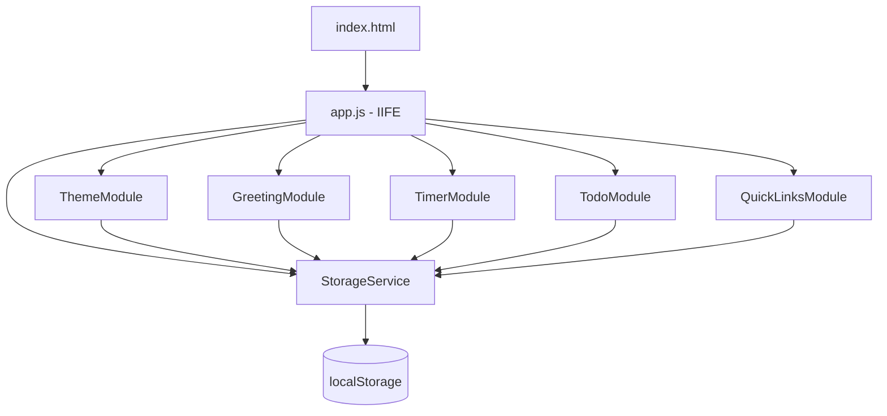
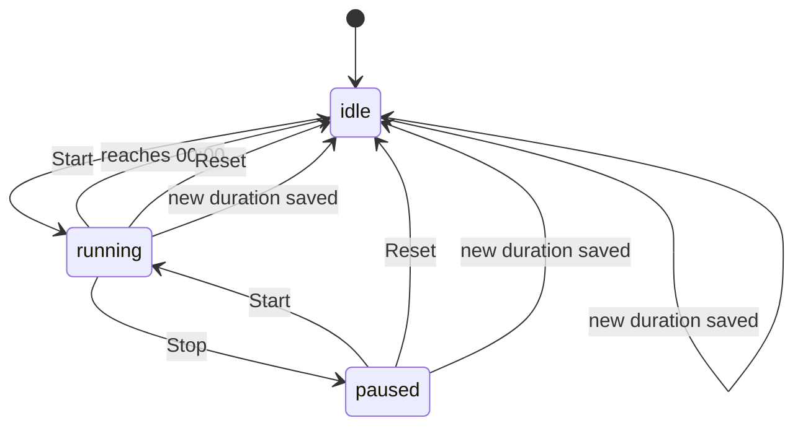

# Design Document — To-Do Life Dashboard

## Overview

The To-Do Life Dashboard is a zero-dependency, client-side single-page web application (SPA). Every feature runs inside a single browser tab — no build step, no server, no network requests. The app is opened directly as `index.html` (or via `file://`) and relies solely on the browser's native APIs (`Date`, `localStorage`, `setTimeout`/`clearInterval`).

The application is composed of five self-contained UI widgets arranged on one page:

| Widget | Primary Responsibility |
|---|---|
| Greeting Widget | Current time, date, time-based greeting, custom user name |
| Pomodoro Timer | Configurable countdown timer (idle / running / paused) |
| To-Do List | Add, edit, mark done, delete tasks; persisted to localStorage |
| Quick Links | Add, delete, open-in-new-tab bookmark buttons; persisted to localStorage |
| Theme Toggle | Light ↔ Dark mode; persisted to localStorage |

All persistent state lives in `localStorage`. On every page load the app reads stored state, hydrates its in-memory model, and renders the UI from that model. Every mutation writes back to `localStorage` immediately.

---

## Architecture

### High-Level Structure

```
index.html          ← single HTML file; markup skeleton for all widgets
css/
  style.css         ← all styles; CSS custom properties drive theming
js/
  app.js            ← all JavaScript; module pattern; no global pollution
```

The JavaScript follows a **module-revealing pattern** — a top-level IIFE (`(function() { … })()`) with clearly separated namespaces for state, storage, each widget, and the initialization routine. There is no framework or transpiler.

### Execution Flow

```
page load
   │
   ├─ StorageService.hydrate()   ← read all localStorage keys
   │
   ├─ ThemeModule.init()         ← apply stored theme to <html>
   ├─ GreetingModule.init()      ← render time/date/greeting; schedule next-minute tick
   ├─ TimerModule.init()         ← render timer at stored / default duration
   ├─ TodoModule.init()          ← render task list from stored tasks
   └─ QuickLinksModule.init()    ← render quick-link buttons from stored links
```

After initialization each module is fully event-driven — DOM event listeners drive all state mutations.

### Module Dependency Diagram



---

## Components and Interfaces

### StorageService

Central gateway for all `localStorage` reads and writes. Every other module calls this; no module touches `localStorage` directly.

```
StorageService
  .hydrate()           → AppState   // reads all keys; returns parsed state object
  .get(key)            → any        // JSON.parse wrapper; returns null on parse error
  .set(key, value)     → boolean    // JSON.stringify + write; returns false on QuotaExceededError
  .remove(key)         → void
```

`hydrate()` reads the four keys (`theme`, `userName`, `sessionDuration`, `tasks`, `quickLinks`) in one pass, validates each, and returns a fully-typed `AppState` object with safe defaults.

---

### GreetingModule

Owns the Greeting Widget section of the DOM.

```
GreetingModule
  .init(state)          → void   // render once, schedule tick
  .render(now, name)    → void   // update DOM: time, date, greeting string
  .getGreeting(hour)    → string // pure function: hour → greeting phrase
  .formatTime(date)     → string // pure function: Date → "HH:MM"
  .formatDate(date)     → string // pure function: Date → "DayName, DD MonthName YYYY"
  .scheduleNextTick()   → void   // setTimeout to the next whole clock-minute
  .saveName(raw)        → void   // trim, validate, persist, re-render
```

**Next-minute scheduling strategy**: Rather than a fixed 60-second interval, `scheduleNextTick` calculates milliseconds until the next whole minute:

```js
const msUntilNextMinute = (60 - now.getSeconds()) * 1000 - now.getMilliseconds();
setTimeout(() => { GreetingModule.render(new Date(), ...); GreetingModule.scheduleNextTick(); }, msUntilNextMinute);
```

This satisfies Requirement 1.2 (synchronise to the system clock, not a fixed interval).

---

### TimerModule

Owns the Pomodoro Timer widget. Timer state machine:



```
TimerModule
  .init(state)              → void
  .start()                  → void
  .stop()                   → void
  .reset()                  → void
  .tick()                   → void   // called every second by setInterval
  .applyNewDuration(mins)   → void   // validate, persist, reset timer
  .renderDisplay(seconds)   → void   // update MM:SS in DOM
  .showAlert(msg)           → void
  .dismissAlert()           → void
```

Internal state kept in a closure:

```js
let timerState = 'idle';   // 'idle' | 'running' | 'paused'
let remainingSeconds = 0;
let intervalId = null;
```

---

### TodoModule

Owns the To-Do List widget.

```
TodoModule
  .init(state)                  → void
  .addTask(rawLabel)            → void   // trim, validate, persist, re-render
  .editTask(id, rawNewLabel)    → void   // trim, validate, persist, re-render
  .toggleTask(id)               → void   // flip done/undone, persist
  .deleteTask(id)               → void   // remove, persist
  .renderList(tasks)            → void   // full list re-render from array
  .renderTask(task)             → HTMLElement
  .persistTasks()               → void   // StorageService.set('tasks', tasks)
  .validateLabel(raw, excludeId)→ { ok, error }
```

Tasks are held in a plain in-memory array that is always the single source of truth; the DOM is a pure projection of this array (full re-render on every change).

---

### QuickLinksModule

Owns the Quick Links widget.

```
QuickLinksModule
  .init(state)              → void
  .addLink(rawLabel, rawUrl)→ void   // validate, persist, re-render
  .deleteLink(id)           → void   // remove, persist, re-render
  .renderLinks(links)       → void
  .validateUrl(raw)         → boolean
  .persistLinks()           → void
```

---

### ThemeModule

Owns the theme-toggle control and the `<html>` class.

```
ThemeModule
  .init(state)    → void   // apply stored theme; wire toggle listener
  .toggle()       → void   // flip light↔dark, persist, apply class
  .apply(theme)   → void   // set class on document.documentElement
```

---

## Data Models

### localStorage Keys

| Key | Type | Default |
|---|---|---|
| `theme` | `"light"` \| `"dark"` | `"light"` |
| `userName` | `string` (1–50 chars trimmed) | _(absent)_ |
| `sessionDuration` | integer 1–90 | `25` |
| `tasks` | `Task[]` JSON array | `[]` |
| `quickLinks` | `QuickLink[]` JSON array | `[]` |

---

### Task Schema

```json
{
  "id": "string (UUID v4 or Date.now().toString())",
  "label": "string (1–255 chars, trimmed)",
  "done": false,
  "createdAt": "string (ISO 8601 UTC, e.g. 2026-10-15T08:30:00.000Z)"
}
```

**Validation rules:**
- `label` after trim must be non-empty and ≤ 255 characters.
- `label` must be unique across all tasks (case-insensitive comparison).
- `done` must be a boolean; any other value is treated as `false` on hydration.
- `createdAt` must be a valid ISO 8601 string; invalid values are replaced with the current timestamp on hydration.
- On load, if the stored value cannot be `JSON.parse`d, or the result is not an array, the entire `tasks` key is discarded and an empty array is used.

---

### QuickLink Schema

```json
{
  "id": "string (UUID v4 or Date.now().toString())",
  "label": "string (1–100 chars, trimmed)",
  "url": "string (must start with http:// or https://, max 2048 chars)"
}
```

**Validation rules:**
- `label` after trim must be non-empty and ≤ 100 characters.
- `url` must start with `http://` or `https://` and be ≤ 2048 characters.
- On load, if the stored value cannot be parsed or is not an array, the entire `quickLinks` key is discarded and an empty array is used.

---

### AppState (in-memory hydrated object)

```js
{
  theme: 'light' | 'dark',       // validated; default 'light'
  userName: string | null,        // null if absent or empty
  sessionDuration: number,        // integer 1–90; default 25
  tasks: Task[],                  // validated array; default []
  quickLinks: QuickLink[]         // validated array; default []
}
```

---

### CSS Architecture

CSS Custom Properties (variables) on `:root` and `html.theme-dark` drive all theming:

```css
/* Light theme (default) */
:root {
  --color-bg: #f5f5f5;
  --color-surface: #ffffff;
  --color-text-primary: #1a1a1a;
  --color-text-secondary: #555555;
  --color-accent: #4a6fa5;
  --color-border: #dddddd;
  --color-done-text: #999999;
}

/* Dark theme */
html.theme-dark {
  --color-bg: #1a1a2e;
  --color-surface: #16213e;
  --color-text-primary: #e0e0e0;
  --color-text-secondary: #a0a0b0;
  --color-accent: #7eb8f7;
  --color-border: #2a2a4a;
  --color-done-text: #555577;
}
```

ThemeModule applies `class="theme-dark"` to `<html>` for dark mode and removes it for light mode. No inline styles are used for theming. The `Theme_Toggle` control is `position: fixed` so it remains visible regardless of scroll position (Requirement 13.1).

---

## Correctness Properties

*A property is a characteristic or behavior that should hold true across all valid executions of a system — essentially, a formal statement about what the system should do. Properties serve as the bridge between human-readable specifications and machine-verifiable correctness guarantees.*

### Property 1: Greeting phrase covers all hours without gaps

*For any* integer hour value in 0–23 (inclusive), `GreetingModule.getGreeting(hour)` SHALL return exactly one of `"Good Morning"`, `"Good Afternoon"`, `"Good Evening"`, or `"Good Night"`, and the result SHALL be consistent with the boundary definitions in Requirements 2.1–2.4.

**Validates: Requirements 2.1, 2.2, 2.3, 2.4**

---

### Property 2: Greeting string format with and without a name

*For any* greeting phrase and any name (including the empty/null case), the composed greeting string SHALL end with `"!"`, SHALL contain the greeting phrase, and IF a non-empty name is present SHALL contain the name preceded by `", "`.

**Validates: Requirements 3.3, 3.4**

---

### Property 3: Task addition round-trip (localStorage persistence)

*For any* valid task label (non-empty, non-whitespace-only, ≤ 255 chars, unique in the list), adding the task and then reading `localStorage.getItem('tasks')` and JSON-parsing it SHALL yield an array containing a Task object whose `label` equals the trimmed input.

**Validates: Requirements 6.2, 6.5**

---

### Property 4: Whitespace-only and empty task labels are always rejected

*For any* string whose characters are all whitespace (spaces, tabs, newlines), submitting it as a task label SHALL leave the task list unchanged and SHALL NOT write a new task to localStorage.

**Validates: Requirements 6.4**

---

### Property 5: Duplicate task label detection is case-insensitive

*For any* existing task list containing at least one task, attempting to add a label that is a case-variant of any existing task label (e.g. `"Buy milk"` when `"buy milk"` exists) SHALL be rejected and the task list SHALL remain unchanged.

**Validates: Requirements 6.3, 7.5**

---

### Property 6: Task toggle is an involution (round-trip on done status)

*For any* task, toggling its status twice SHALL leave `done` equal to its original value — i.e. `toggle(toggle(task.done)) === task.done`.

**Validates: Requirements 8.2, 8.3**

---

### Property 7: Task list persistence round-trip (serialization)

*For any* array of valid Task objects, serializing to JSON and then deserializing via `StorageService.hydrate()` SHALL produce an array of Tasks that is deeply equal to the original (same `id`, `label`, `done`, `createdAt` values).

**Validates: Requirements 10.1, 10.3**

---

### Property 8: Malformed localStorage data yields an empty list

*For any* string that cannot be parsed as a JSON array (including `null`, `undefined`, non-array JSON values, and malformed JSON), `StorageService.hydrate()` SHALL return an empty array for `tasks` and for `quickLinks` respectively.

**Validates: Requirements 10.3, 11.7**

---

### Property 9: Quick Link URL validation

*For any* string submitted as a Quick Link URL, `QuickLinksModule.validateUrl(url)` SHALL return `true` if and only if the string starts with `http://` or `https://` and has length ≤ 2048.

**Validates: Requirements 11.4**

---

### Property 10: Session duration validation covers full integer range

*For any* numeric input value, `TimerModule.applyNewDuration` SHALL accept it if and only if it is an integer in [1, 90]. For every rejected value the timer state SHALL remain unchanged and localStorage SHALL not be updated.

**Validates: Requirements 5.1, 5.5**

---

### Property 11: Timer reset always restores to current Session_Duration

*For any* timer state (`idle`, `running`, or `paused`) and any valid Session_Duration value d, activating Reset SHALL transition the timer to `idle` with `remainingSeconds === d * 60`.

**Validates: Requirements 4.4**

---

### Property 12: Theme toggle is an involution

*For any* starting theme (`"light"` or `"dark"`), toggling twice SHALL restore the theme to its original value, and the `<html>` element's class list SHALL reflect the original theme.

**Validates: Requirements 13.2, 13.3**

---

### Property 13: Theme persistence round-trip

*For any* valid theme value (`"light"` or `"dark"`), after `ThemeModule.toggle()` is called, reading `localStorage.getItem('theme')` SHALL return the new theme value as a string.

**Validates: Requirements 13.4**

---

## Error Handling

| Scenario | Behavior |
|---|---|
| `localStorage` write fails (QuotaExceededError) | StorageService.set returns `false`; calling module shows inline error message; in-memory state is retained for the session |
| `localStorage` value cannot be JSON-parsed | `StorageService.get` returns `null`; hydrate uses safe defaults |
| `tasks` / `quickLinks` parse result is not an array | Discarded; empty array used; malformed key overwritten |
| `theme` value is not `"light"` or `"dark"` | Defaults to `"light"`; invalid value overwritten |
| `sessionDuration` is out of range or non-integer | Defaults to 25; invalid value overwritten |
| Timer reaches 00:00 | Transitions to `idle`; shows dismissible alert |
| Empty / whitespace task input | Inline validation message; no state change |
| Duplicate task label (case-insensitive) | Inline warning message; no state change |
| Invalid Quick Link URL | Inline validation message; no state change |
| Name field: whitespace-only with existing name | Inline validation message; no state change; existing name preserved |
| Name field: empty / whitespace (clear intent) | Removes `userName` from localStorage; greeting updates |

All inline messages are rendered adjacent to the relevant input and cleared as soon as the user modifies that input.

---

## Testing Strategy

### Dual Testing Approach

Unit tests verify specific examples, edge cases, and error conditions. Property-based tests verify universal properties across randomly generated inputs. Both are needed for comprehensive coverage.

### Property-Based Testing Library

Use **[fast-check](https://github.com/dubzzz/fast-check)** (TypeScript/JavaScript PBT library) for all property tests. Configure each test to run a minimum of **100 iterations**.

Each property test MUST include a comment tag in the format:
```
// Feature: todo-life-dashboard, Property N: <property_text>
```

### Unit Tests (example-based)

Focus on:
- Specific boundary values for greeting hours (4:59, 5:00, 11:59, 12:00, 17:59, 18:00, 20:59, 21:00)
- Timer state machine transitions (all valid and invalid transitions)
- DOM rendering: strikethrough applied/removed on task toggle
- Alert display and dismissal on timer completion
- Input field cleared after successful task add
- Quick Link opens in new tab (`target="_blank"`)
- Page load with no localStorage keys (all defaults apply)
- Page load with valid stored state (all widgets hydrated correctly)
- Theme applied before first render (no flash of wrong theme)

### Property Tests (universal, mapped to design properties)

| Test | Design Property | fast-check Arbitraries |
|---|---|---|
| Greeting phrase completeness | Property 1 | `fc.integer({ min: 0, max: 23 })` |
| Greeting string format | Property 2 | `fc.string()`, `fc.option(fc.string())` |
| Task add round-trip | Property 3 | `fc.string({ minLength: 1 }).filter(s => s.trim().length > 0)` |
| Whitespace rejection | Property 4 | `fc.stringOf(fc.constantFrom(' ', '\t', '\n'))` |
| Case-insensitive duplicate detection | Property 5 | `fc.string()`, `fc.string().map(s => randomCase(s))` |
| Toggle involution | Property 6 | `fc.boolean()` |
| Task serialization round-trip | Property 7 | `fc.record({ id, label, done, createdAt })` |
| Malformed data → empty list | Property 8 | `fc.anything().filter(x => !Array.isArray(x))` |
| URL validation | Property 9 | `fc.string()`, valid URL arbitraries |
| Session duration validation | Property 10 | `fc.integer()`, `fc.float()`, `fc.string()` |
| Reset restores Session_Duration | Property 11 | `fc.integer({ min: 1, max: 90 })`, `fc.constantFrom('idle','running','paused')` |
| Theme toggle involution | Property 12 | `fc.constantFrom('light', 'dark')` |
| Theme persistence round-trip | Property 13 | `fc.constantFrom('light', 'dark')` |

### Integration / Smoke Tests

- App loads and renders all widgets with empty localStorage (smoke test)
- App loads and correctly hydrates all widgets from a fully-populated localStorage (integration)
- `file://` protocol: no network errors, no mixed-content errors
- Cross-browser: verified manually in Chrome, Firefox, Edge, Safari stable
